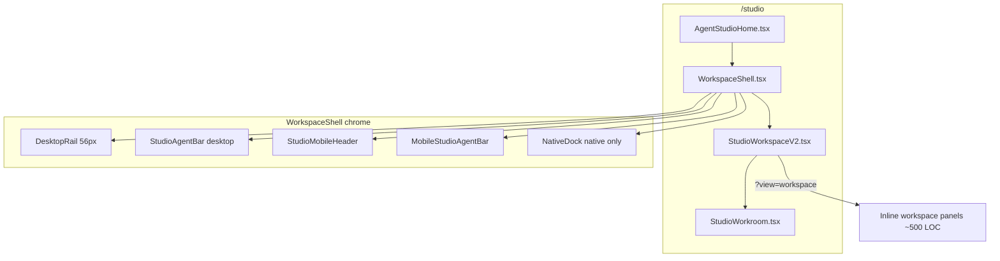
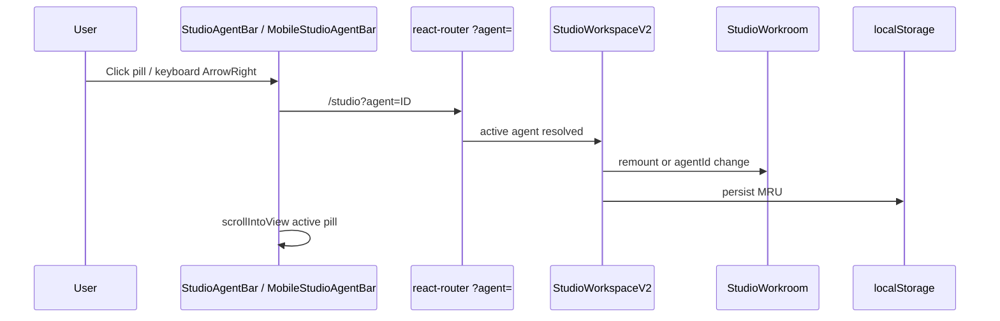
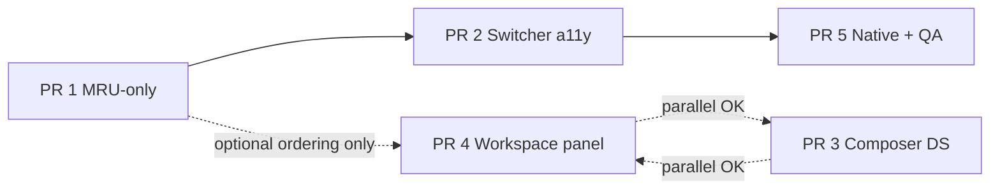

# Wireline Studio Canvas UX Overhaul

| Field | Value |
|-------|-------|
| **Author** | Systems architecture (Grok) |
| **Date** | 2026-06-27 |
| **Status** | Draft — partial implementation in working tree |
| **Scope** | Authenticated `/studio` canvas for multi-agent accounts (founder seed: 17+ agents; target: 20+) |

---

## Overview

Wireline Studio is the authenticated **run surface** — chat-first command of agents. The overhaul replaces an unusable agent-card grid and vertical rail avatar stack with:

1. **Default canvas** = composer for the active agent (no cards).
2. **Horizontal agent switcher** on desktop top bar and mobile bottom bar.
3. **Minimal 56px left rail** = logo + settings only.
4. **Deep per-agent workspace** (onboarding, voice, World Connections, Brain) behind `?view=workspace`.

**~70% of the structural work is already merged** (`2eb2c078`, `b82b210c`, `32771e71`). This document audits **current vs target** and defines **incremental PRs** for polish, scale, MRU, native shell, contracts, and visual QA.

---

## Background & Motivation

### User-reported problem (founders seeded account)

On `/studio`, authenticated users with many agents (founder fleet: 6 Wireline personas + 11 specialty templates = **17 seeded agents**, often 20+ with extras) experienced:

| Issue | Symptom |
|-------|---------|
| Agent card grid | 20 cards — dense, ugly, not scannable |
| No default composer | Canvas felt empty until picking a card |
| Vertical rail avatar stack | Side rail exploded with 2+ agents |
| Workspace depth on canvas | Voice/integrations/brain competed with chat |

### Recent merge context

```
2eb2c078 feat(studio): agent-centric workspaces, persistent rail, StudioWorkroom
b82b210c refine(ui): thin studio bar
32771e71 fix(structure): WorkspaceShell persistent side rail
0b75b901 perf(a11y+polish): onboarding panel label fixes
```

These commits established the shell, switcher bars, chat-first routing, and `view=workspace` split layout. Remaining work is **production polish**, not greenfield architecture.

---

## Goals & Non-Goals

### Goals

| # | Goal | Success criteria |
|---|------|------------------|
| G1 | Chat-first canvas | `/studio` lands on composer for active agent within one paint after agents load |
| G2 | Agent switcher bar | Horizontal scroll pills (desktop top, mobile bottom); `+` create; settings gear |
| G3 | Minimal left rail | 56px: `WirelineMark` → `/studio` + settings only — **no agent stack** |
| G4 | Workspace depth behind toggle | Onboarding/voice/World Connections/Brain only at `?view=workspace` |
| G5 | Scale to 20+ agents | Scroll, compact pills, no layout explosion; optional search at 15+ |
| G6 | A11y | Keyboard agent nav, `aria-*` on switcher toolbar, **44px** touch targets |
| G7 | Contracts | `wireline-design-vision.ts`, `authenticated-agent-flow-contract.test.ts`, `check-wireline-clear-system.mjs` |

### Non-Goals

- Replacing Training (`/training`) or Wire (`/actions`) as config-heavy surfaces.
- New backend agent APIs (reuse `AgentsContext`, existing config routes).
- Marketing/public page changes.
- Full rewrite of `StudioOverview.tsx` (deprecate / redirect legacy links only).

---

## Current vs Target Audit

### Architecture (as implemented)



### Component status matrix

| Component / behavior | Current (working tree) | Target | Gap |
|----------------------|------------------------|--------|-----|
| **DesktopRail** (`WorkspaceShell.tsx:296–324`) | Logo + settings; no agent icons | Same | ✅ Done |
| **StudioAgentBar** (`:122–211`) | Horizontal pills, `+`, settings, Workspace toggle | 44px pills + scroll-into-view (PR 2) | 🟡 Polish |
| **MobileStudioAgentBar** (`:259–294`) | Fixed bottom, compact pills, `+` | 44px targets; safe-area tested at 20+ pills | 🟡 Polish |
| **NativeDock** (`:326–347`) | Studio + Settings tabs only | Agent switcher or sheet in native shell | 🔴 Gap |
| **Card grid removed** (`StudioWorkspaceV2.tsx:110`) | Comment + no grid render | No cards ever on default canvas | ✅ Done |
| **Auto-select agent** (`:111–121`) | `agents[0]` when no `?agent=` | **MRU** from `localStorage` | 🔴 Gap |
| **Chat composer** (`StudioWorkroom.tsx:472–530`) | Always visible; `layout=canvas` on default | Uses `wl-composer-dock` utilities | 🟡 Polish |
| **`view=workspace`** (`StudioWorkspaceV2.tsx:253–767`) | Split: chat capped `48–52dvh` + scrollable panels | Extracted component; real API wiring | 🟡 Partial |
| **Onboarding panel** | Voice gallery, personality, knowledge — demo `alert()` | Persist via existing config APIs | 🟡 Partial |
| **A11y keyboard nav** | Pills are `<Link>` only | Roving `tablist` + Arrow/Home/End | 🔴 Gap |
| **Touch targets** | Pills `min-h-[32px]` (`:102`) | 44px per `WIRELINE_DESIGN_VISION` | 🔴 Gap |
| **Legacy `mode=workroom`** | Still linked from `OverviewPage`, `StudioOverview`, `StudioWorkspaceV2` | Redirect to canvas (param ignored today) | 🟡 Cleanup |
| **Contracts** | `view=workspace`, `StudioAgentBar`, minimal rail asserted | Add MRU, a11y, 44px, native switcher | 🟡 Extend |

### URL routing model

| URL | Behavior today | Target |
|-----|----------------|--------|
| `/studio` | Replace → `?agent=<first\|mru>` | `?agent=<mru>` |
| `/studio?agent=ID` | Chat canvas (`layout=canvas`) | Same |
| `/studio?agent=ID&view=workspace` | Split chat + workspace panels | Same (extract panels) |
| `/studio?create=1` | Opens `CreateAgentDialog` | Same |
| `/studio?agent=ID&mode=workroom` | **Ignored** — renders canvas anyway | 301/replace → drop `mode` |
| `/studio?agent=ID&command=...` | Passed to `StudioWorkroom` as `initialCommand` | Same |

---

## Proposed Design

### 1. Chat-first canvas (default)

**Entry:** `AgentStudioHome` → `WorkspaceShell` → `StudioWorkspaceV2`.

When `agents.length > 0` and `?agent` is absent:

1. Read `wireline:studio:last-agent-id` from `localStorage` (new).
2. If MRU id exists in roster → `replace` URL with that agent.
3. Else → first agent in roster order (current behavior).
4. Render `StudioWorkroom` with `layout="canvas"` — composer dock pinned bottom, messages scroll above, clear button top-right (`StudioWorkroom.tsx:251–252`).

Empty roster: `StudioEmptyState` with wired brief → `?create=1` (textarea submit not yet wired — polish item).

### 2. Agent switcher bar



**Desktop** (`StudioAgentBar`):

- `role="toolbar"` + inner `role="tablist"` for pills (upgrade from plain links).
- Canvas label, scrollable pill row (`overflow-x-auto`, hidden scrollbar — already present).
- `+` → `/studio?create=1`.
- Settings → `/settings`.
- Workspace toggle (sm+): toggles `view=workspace` preserving `agent`.

**Mobile**:

- `StudioMobileHeader`: active agent name + workspace toggle + settings.
- `MobileStudioAgentBar`: fixed bottom; `pb-[max(0.5rem,env(safe-area-inset-bottom))]`; only when `!nativeAppShell` (`WorkspaceShell.tsx:464–466`).

**Scale (20+ agents)**:

- Phase 1: horizontal scroll + compact pills (initials-only below `sm`) — **done**.
- Phase 2: when `agents.length >= 15`, show search/filter chip opening inline filter or `CommandBar`-style agent picker (reuse pattern from `CommandBar.tsx`).

### 3. Minimal left rail

`DesktopRail` — 56px (`w-[56px]`), `WirelineMark` links to `/studio`, settings at `mt-auto`. **No** `Bot` icons, no per-agent stack. Matches design requirement and `authenticated-agent-flow-contract.test.ts`.

### 4. Workspace depth (`?view=workspace`)

Toggle via bar link or `StudioWorkroom` `onBack` when `layout="split"`.

**Layout:**

- Top: `StudioWorkroom` `layout="split"` with `max-h-[48dvh] lg:max-h-[52dvh]`.
- Bottom: scrollable workspace — sections already named in code:
  - Onboard & Customize (voice gallery, personality, greeting, knowledge)
  - World Connections (catalog-driven integrations)
  - Brain / Record / Controls

**Refactor target:** extract `StudioAgentWorkspacePanel.tsx` from `StudioWorkspaceV2.tsx:267–767` to isolate demo state and enable testing.

### 5. Agent discovery without cards

Agents remain discoverable via:

1. Horizontal switcher (primary).
2. `/agents` fleet page (unchanged).
3. Overview quick links (`OverviewPage.tsx`).
4. Command bar / Director (existing).
5. Optional overflow search at scale.

No agent **cards** on default canvas.

### 6. Design system alignment

`StudioWorkroom` composer should adopt shared primitives:

```tsx
// Target (StudioWorkroom.tsx composer section)
<div className={WL_COMPOSER_CLASSES.composerDock}>
  <textarea className="wl-composer-dock__input" ... />
  <div className="wl-composer-dock__toolbar">...</div>
</div>
```

Copy from `WORKSPACE_VOICE.directAgent(agentName)` (`product-copy.ts:16`) for placeholder parity with Overview composer.

### 7. MRU persistence

```ts
// src/lib/studio-agent-preference.ts (new)
const KEY = "wireline:studio:last-agent-id";

export function readStudioLastAgentId(): string | null;
export function writeStudioLastAgentId(id: string): void;
```

- Write on every `?agent=` navigation (hook in `StudioWorkspaceV2` — PR 1 scope; shell does not write MRU).
- Validate against current roster before apply.
- No server persistence in v1 (client-only, privacy-friendly).

### 8. Accessibility

| Requirement | Implementation |
|-------------|----------------|
| 44px touch targets | `min-h-[44px] min-w-[44px]` on pills, `+`, settings |
| Keyboard nav | `role="tablist"`; ArrowLeft/Right move focus; Enter activates; Home/End |
| Labels | `aria-label` per agent name (present); `aria-current="true"` on active (present) |
| Focus visible | `focus-visible:outline-2 focus-visible:outline-primary/40` (extend to all switcher controls) |
| Skip link | `wl-skip-link` → `#workspace-main` (present in shell) |

### 9. Native app shell

`isNativeAppShell()` (`WorkspaceShell.tsx:22–34`) gates:

- `MobileStudioAgentBar` **off** when native.
- `NativeDock` **on** with Studio + Settings only.

**Gap:** Native users lack agent switcher. **Target:** Add horizontal agent strip above `NativeDock` or Studio tab opens agent sheet — mirror `MobileStudioAgentBar` inside native layout without duplicating `MobileBrowserUtilities`.

---

## API / Interface Changes

### URL / routing (client only)

| Change | Type |
|--------|------|
| Persist MRU via `localStorage` | New util `studio-agent-preference.ts` |
| Strip/ignore `mode=workroom` | `useEffect` replace in `StudioWorkspaceV2` |
| `view=workspace` | Stable — document in design vision |

### React component interfaces

| Component | Change |
|-----------|--------|
| `AgentSwitcherPill` | Add `onSelect`, `tabIndex`, `id` for roving tabindex |
| `StudioWorkspaceV2` | MRU effect; extract `StudioAgentWorkspacePanel` |
| `StudioWorkroom` | Optional `className` on composer; adopt `WL_COMPOSER_CLASSES` |
| `WorkspaceShell` | Switcher a11y + scroll (PR 2); native agent strip (PR 5) — no MRU writes |

### Design vision manifest

Extend `WIRELINE_DESIGN_VISION` (`wireline-design-vision.ts`):

```ts
studioCanvas: {
  defaultSurface: "chat-composer",
  agentSwitcher: "horizontal-bar",
  railWidthPx: 56,
  workspaceDepthParam: "view=workspace",
  minTouchTargetPx: 44,
},
```

### Contract test updates

**`tests/authenticated-agent-flow-contract.test.ts`:**

- Assert `studio-agent-preference` or `wireline:studio:last-agent-id`.
- Assert no `mode=workroom` in `StudioWorkspaceV2` links (after cleanup).
- Assert `role="tablist"` or keyboard handler on switcher.

**`scripts/check-wireline-clear-system.mjs`:**

- Assert `min-h-[44px]` on `AgentSwitcherPill`.
- Assert MRU helper imported in `StudioWorkspaceV2`.
- Optionally assert `StudioAgentWorkspacePanel` extraction.

---

## Key Decisions

| # | Decision | Rationale |
|---|----------|-----------|
| KD1 | **Chat-first default; workspace behind `?view=workspace`** | Separates run surface from config depth; matches Cursor/ChatGPT mental model |
| KD2 | **Agents in top/bottom bar, not side rail** | Side rail scales O(1); vertical agent stack fails at 20+ |
| KD3 | **MRU in `localStorage`, not server** | Fast, no API churn; roster validation on read is sufficient |
| KD4 | **Keep `AgentsContext` as single roster source** | Already powers shell + canvas; no duplicate fetches |
| KD5 | **Extract workspace panel, don't delete catalogs** | `World Connections` must keep `WORKSPACE_INTEGRATION_CATALOG` + `AGENT_TOOL_CATALOG` fidelity per contracts |
| KD6 | **Deprecate `mode=workroom` silently** | Param already ignored; chat-first merge made it redundant |
| KD7 | **Native shell gets agent strip in PR 5** | Avoid blocking web ship; native is smaller surface |
| KD8 | **Composer uses `wl-composer-dock`** | One elevation language per `WIRELINE_DESIGN_VISION` |

---

## Alternatives Considered

| Alternative | Why rejected |
|-------------|--------------|
| Agent dropdown instead of pills | Hides fleet; poor discoverability for 20 named agents |
| Keep card grid as secondary view | User explicitly rejected cards; switcher is faster |
| Server-side MRU preference | Adds API + auth edge cases; local MRU sufficient for v1 |
| Full-page workspace (no split chat) | Loses chat context while configuring; split preserves moat |
| Reuse `StudioOverview` as default | Overview-style centered header competes with composer-first |
| Vertical rail icons with scroll | Still narrow hit targets; horizontal bar matches mobile thumb zone |

---

## Security & Privacy

- **MRU `localStorage`**: Stores agent UUID only; no PII. Cleared on explicit logout if we add `localStorage` purge to auth sign-out (optional hardening).
- **URL `?agent=`**: Agent IDs already exposed in fleet URLs; no new leakage.
- **Workspace panels**: Continue `authFetch` for voice/config — no change to auth boundaries.
- **Founder seed data**: Scale testing uses seeded roster; no production customer data in QA captures.

---

## Observability

| Signal | Mechanism |
|--------|-----------|
| Agent switch latency | `performance.mark` on `?agent=` change (optional PR 2) |
| MRU hit rate | `console.debug` behind dev flag or analytics event `studio_agent_mru_hit` |
| Roster size layout | Visual QA script with 20-agent fixture |
| Contract drift | `npm run design:check` + `authenticated-agent-flow-contract.test.ts` in CI |
| A11y regressions | axe-core on `/studio` in visual QA harness (extend `capture-prod-visual-qa.mjs`) |

---

## Rollout Plan

| Phase | Audience | Actions |
|-------|----------|---------|
| **0 — Now** | Dev / founders | Working tree already chat-first; dogfood with founder seed |
| **1 — PR 1 then PR 2** | Internal | MRU (PR 1), then switcher a11y + scroll (PR 2) — **sequential**, not parallel |
| **2 — PR 3 & PR 4** | Staged | Composer DS alignment (PR 3); workspace panel extraction (PR 4) — may land in parallel |
| **3 — PR 5** | Production | Native shell, legacy URL cleanup, contract + visual QA |
| **4 — Post-ship** | All authenticated | Agent search at 15+ if analytics show switcher friction |

**Rollback:** Revert to `agents[0]` default by removing MRU read; shell structure is backward-compatible.

---

## Open Questions

| # | Question | Owner | Default if unresolved |
|---|----------|-------|----------------------|
| OQ1 | Agent search threshold: 15 vs 20? | Product | 15 |
| OQ2 | Should logout clear MRU? | Security | Yes, add to sign-out |
| OQ3 | Native agent strip: bottom duplicate vs sheet from Studio tab? | Mobile | Bottom strip matching web |
| OQ4 | Split view chat height: fixed `dvh` vs user-resizable? | Design | Keep fixed for v1 |
| OQ5 | Wire `StudioEmptyState` textarea to `?create=1&brief=...`? | UX | Yes in PR 3 |

---

## References

| Resource | Path |
|----------|------|
| Workspace shell | `src/components/WorkspaceShell.tsx` |
| Studio canvas | `src/components/StudioWorkspaceV2.tsx` |
| Chat workroom | `src/components/StudioWorkroom.tsx` |
| Studio route | `src/pages/AgentStudioHome.tsx` |
| Agents roster | `src/contexts/AgentsContext.tsx` |
| Design vision | `src/lib/wireline-design-vision.ts` |
| Product copy | `src/lib/product-copy.ts` |
| Flow contract test | `tests/authenticated-agent-flow-contract.test.ts` |
| Clear system check | `scripts/check-wireline-clear-system.mjs` |
| Founder fleet scale | `src/lib/founder-fleet-seed.ts` (`EXPECTED_FOUNDER_FLEET_AGENT_COUNT`) |
| Composer utilities | `src/styles/design-system.css` (`.wl-composer-dock`) |

---

## PR Plan

### PR dependency graph

PRs must merge in dependency order where edges exist. **PR 1 and PR 2 must not be developed or merged in parallel** — they previously overlapped on `WorkspaceShell.tsx`; file ownership is now explicit.



| PR | Owns (no overlap) | Blocks |
|----|-------------------|--------|
| PR 1 | `studio-agent-preference.ts`, MRU logic in `StudioWorkspaceV2.tsx` | PR 2 |
| PR 2 | All `WorkspaceShell.tsx` switcher changes (pills, bars, scroll, keyboard) | PR 5 |
| PR 3 | `StudioWorkroom.tsx`, empty-state in `StudioWorkspaceV2.tsx`, design vision | — |
| PR 4 | `StudioAgentWorkspacePanel.tsx`, workspace state/API in extracted panel | — |
| PR 5 | Native strip, legacy URLs, visual QA (touches shell after PR 2 lands) | — |

---

### PR 1: MRU agent selection (MRU-only scope)

**Files/components affected:**

- `src/lib/studio-agent-preference.ts` (new)
- `src/components/StudioWorkspaceV2.tsx` — replace `agents[0]` default with MRU; write MRU on `?agent=` change
- `tests/studio-agent-preference.test.ts` (new, unit)

**Does not touch:** `WorkspaceShell.tsx` (owned by PR 2 to avoid merge conflicts).

**Dependencies:** None (builds on merged shell)

**Description:**

- Add `readStudioLastAgentId` / `writeStudioLastAgentId` with roster validation.
- On agent navigation, persist MRU in `StudioWorkspaceV2` only.
- Unit tests for MRU invalid-id fallback.
- **Out of scope for this PR:** `scrollIntoView`, pill sizing, keyboard nav — deferred to PR 2.

---

### PR 2: Accessibility, 44px targets, scroll-into-view & 20+ agent scale

**Files/components affected:**

- `src/components/WorkspaceShell.tsx` — `AgentSwitcherPill`, `StudioAgentBar`, `MobileStudioAgentBar`; `scrollIntoView` for active pill via `ref` + `useEffect`
- `src/hooks/useRovingTabIndex.ts` (new) or inline keyboard handler
- `tests/authenticated-agent-flow-contract.test.ts`
- `scripts/check-wireline-clear-system.mjs`

**Dependencies:** **PR 1 (required — merge sequentially).** PR 1 lands first with zero `WorkspaceShell` edits; this PR is the sole owner of switcher shell changes.

**Description:**

- Bump pill and `+` button to `min-h-[44px] min-w-[44px]`.
- Implement `role="tablist"` + Arrow/Home/End keyboard navigation between agents.
- Scroll active pill into center of horizontal scroller on desktop and mobile.
- Add `data-agent-count` test fixture or stub roster test for 20 pills without layout overflow assertions.
- Update design vision `minTouchTargetPx: 44` enforcement in `design:check`.

---

### PR 3: Composer design-system alignment & empty-state wiring

**Files/components affected:**

- `src/components/StudioWorkroom.tsx` — adopt `WL_COMPOSER_CLASSES.composerDock`, `wl-chip-suggestion`
- `src/components/StudioWorkspaceV2.tsx` — `StudioEmptyState` brief → `?create=1` with encoded brief
- `src/lib/wireline-design-vision.ts` — `studioCanvas` metadata
- `tests/wireline-design-vision-contract.test.ts`

**Dependencies:** None

**Description:**

- Replace bespoke composer border classes with shared `wl-composer-dock` utilities.
- Use `WORKSPACE_VOICE.directAgent` for placeholder.
- Wire empty-state textarea Enter/submit to create flow.
- Document chat-first canvas in design vision manifest.

---

### PR 4: Workspace panel extraction & real config wiring

**Files/components affected:**

- `src/components/StudioAgentWorkspacePanel.tsx` (new, extracted from `StudioWorkspaceV2.tsx:267–767`)
- `src/components/StudioWorkspaceV2.tsx` — slim orchestrator
- Remove `alert()` / `document.querySelector` hacks in voice test bridge
- `tests/authenticated-agent-flow-contract.test.ts` — assert extraction

**Dependencies:** None (workspace extraction and config API wiring are independent of composer dock classes in PR 3). May land in parallel with PR 3.

**Description:**

- Extract workspace depth into dedicated panel component.
- Wire `applySetup` to existing `authFetch` PATCH routes (`/api/agent-config/.../voice`, manual, train extract).
- Replace demo placeholders with loading/error states.
- Keep `World Connections`, `Brain` section titles for contract stability.

---

### PR 5: Native shell agent switcher, legacy URL cleanup & visual QA

**Files/components affected:**

- `src/components/WorkspaceShell.tsx` — `NativeStudioAgentBar` or extend `NativeDock`
- `src/components/StudioWorkspaceV2.tsx` — strip `mode=workroom` from internal links; URL normalize effect
- `src/pages/OverviewPage.tsx`, `src/components/StudioOverview.tsx` — update links to `/studio?agent=ID`
- `scripts/capture-prod-visual-qa.mjs` — `/studio` with multi-agent fixture
- `tests/authenticated-agent-flow-contract.test.ts`
- `scripts/check-wireline-clear-system.mjs`

**Dependencies:** PR 1–2 (switcher behavior stable)

**Description:**

- Add agent switcher for `nativeAppShell` users (currently missing).
- Global replace `mode=workroom` → bare `?agent=` links.
- Add `useEffect` to `replace` legacy `mode` param if present in URL.
- Visual QA screenshots: default canvas, `view=workspace`, 20-agent switcher scroll.
- Final contract sync for native + legacy cleanup.

---

**PR count:** 5 incremental PRs (remaining work after partial implementation).

**Key gaps identified:**

1. MRU agent selection (defaults to first agent only).
2. 44px touch targets and keyboard navigation missing on switcher.
3. Native app shell has no agent switcher.
4. Legacy `mode=workroom` links still in codebase.
5. Workspace panel monolith with demo-quality `applySetup`.
6. `StudioWorkroom` not using `wl-composer-dock` design utilities.
7. No agent search/filter for 15+ agents (scale edge case).

**Blockers:**

- **None architectural** — chat-first shell is merged and contracts pass.
- **Soft blocker:** Native shell agent UX undefined in product — default to mirroring `MobileStudioAgentBar` (OQ3).
- **Build:** Recent `6662c28d` fixed stale voice imports; verify CI green before PR 4 API wiring.