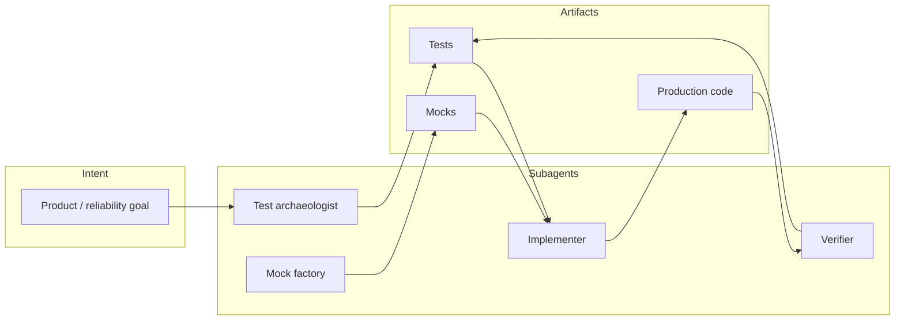

# Subagent-driven TDD patterns (Wireline)

This document captures how we use **intent-driven development** with **specialized subagent roles**, **Vitest**, and **database mocks** so large server modules stay testable without spinning up Postgres.

## Workflow (high level)



1. **Test archaeologist** — Maps production entry points, data dependencies, and failure modes; proposes test matrix (happy path, empty data, auth/tenant boundaries, retries).
2. **Mock factory** — Builds chainable Drizzle mocks, hoisted `vi.mock` factories, and timer-based async (`startWorker`) harnesses.
3. **Implementer** — Applies the smallest production change that satisfies intent.
4. **Verifier** — Runs `npm run test:run`, tightens assertions, removes dead mock surface.

## Drizzle ORM: chainable query mocks

Drizzle query builders are **fluent**. `mockReturnThis()` on the root object is wrong when the chain forks (e.g. `insert().values()` vs `select().from().where()`).

### Pattern A — single shared chain object

Used in `src/__tests__/campaign-dialer.test.ts`:

- Every method returns the same `chain` object (or a terminal `Promise`) so `.select().from().where().limit()` works.
- Use **call counters** when one test triggers multiple `.where()` branches with different return shapes.

### Pattern B — terminal `insert().values()`

Used in `src/lib/audit-logger.test.ts`:

```typescript
const insertChain = { values: vi.fn(() => Promise.resolve({ success: true })) };
const mockDb = { insert: vi.fn(() => insertChain) };
```

Assert on `insertChain.values` to inspect inserted row shape (camelCase columns as in application code, not raw SQL names).

### Pattern C — `transaction` + top-level `update`

`src/lib/job-queue.ts` uses **both**:

- `claimJob` → `db.transaction(tx => tx.select…for('update'…); tx.update…returning())`
- `completeJob` / `failJob` → `db.update(…).set(…).where(…)`

Tests must mock **`tx` chains separately** from **`db.update` chains** (`src/lib/job-queue.test.ts`).

### Pattern D — `sql.raw` passed to `execute`

`String(sqlObject)` is useless. Prefer inspecting `queryChunks` on the `SQL` instance or assert on **observable side effects** (`log`, return value) when strings are awkward.

## Fake timers + `startWorker`

`startWorker` schedules `setTimeout(sweep, 0)` then reschedules after each sweep. In Vitest:

- `vi.useFakeTimers()`
- `await vi.runOnlyPendingTimersAsync()` to flush the initial sweep and in-sweep `await`s
- `stop()` clears the timer; advance time **after** `stop()` and assert **no new** `transaction` / `claim` activity

## Job queue / worker: what is worth testing

| Layer        | Test focus |
|-------------|------------|
| `job-queue` | `enqueue`, `claimJob`, `completeJob`, `failJob` (retry vs dead-letter), `getQueueStats`, `startWorker` error paths |
| `job-worker`| `handleJob` branches with **hoisted** `server-context` mocks; dynamic `import()` targets need **real `class` constructors** in `vi.mock` |

## Decomposing `src/lib/claude-brain.ts` (subagent playbook)

`claude-brain.ts` is intentionally monolithic: one Anthropic client, shared audit capture, and many “recipe” entry points. Decomposition should be **incremental** and **test-first** so exports stay stable for `server.ts` and `job-worker.ts`.

### Suggested module boundaries (by existing section banners)

| Future module (suggested) | Responsibility | Primary consumers |
|---------------------------|------------------|-------------------|
| `claude-brain-client.ts` | `getClient`, `CLAUDE_MODEL_DEFAULT`, `isClaudeAvailable`, `ClaudeUnavailableError` | All callers |
| `claude-brain-audit.ts` | `withAuditCapture`, `createAuditContext`, `estimateCost`, AsyncLocalStorage wiring | Middleware, recipes |
| `claude-brain-tools.ts` | `TOOLS`, `runStructured`, `runCompletion`, shared tool schemas | Recipes, scoring |
| `claude-brain-recipes-sales.ts` | `brief`, `qualify`, `objectionDrill`, `coldEmail`, … | Voice / sales routes |
| `claude-brain-recipes-ops.ts` | `dailyBrief`, `clusterTopics`, `clusterFailureModes`, … | Dashboard / analytics |
| `claude-brain-recipes-voice.ts` | `postCallAnalysis`, `coach`, `forgeAgent`, `qaScore`, … | Webhooks, jobs |
| `claude-brain-v2a.ts` | `extractActions`, `synthesizeLesson` | `job-worker` |
| `claude-brain-calendar.ts` | `buildCalendarContext`, calendar row types | Server routes |

### Mechanical extraction steps

1. **Freeze behavior** — Add characterization tests around pure helpers first (`estimateCost`, `buildCalendarContext`) and thin adapter tests for `runStructured` with a mocked `Anthropic` client (optional follow-up).
2. **Move, do not rewrite** — Move blocks verbatim; only adjust imports/exports.
3. **Barrel re-export** — Keep `claude-brain.ts` as `export * from './claude-brain-client'` etc. until all imports are migrated, then delete the barrel.
4. **Job-worker coupling** — After splitting, `job-worker.ts` should import only `postCallAnalysis`, `extractActions`, `synthesizeLesson` from the smaller modules to reduce cold-load cost in tests.

### Subagent task template (copy/paste)

```text
Goal: [one sentence intent]
Scope: [files/functions only — no drive-by refactors]
Contract: [public signatures that must not change]
Tests: [list cases — happy, empty, error, retry]
Mocks: [Drizzle pattern A/B/C, timers, dynamic import]
Done when: `npm run test:run` green; PR description lists risk + rollback
```

## References in this repo

- `src/__tests__/campaign-dialer.test.ts` — chain + `whereCallCount`
- `src/lib/audit-logger.test.ts` — `insert().values()` terminal
- `src/lib/job-queue.test.ts` — `transaction` / `update` / fake timers
- `src/lib/job-worker.test.ts` — hoisted `m` object, `class` mock for dynamic import
- `src/__tests__/job-queue-monitoring.test.ts` — cron / ops documentation tests
