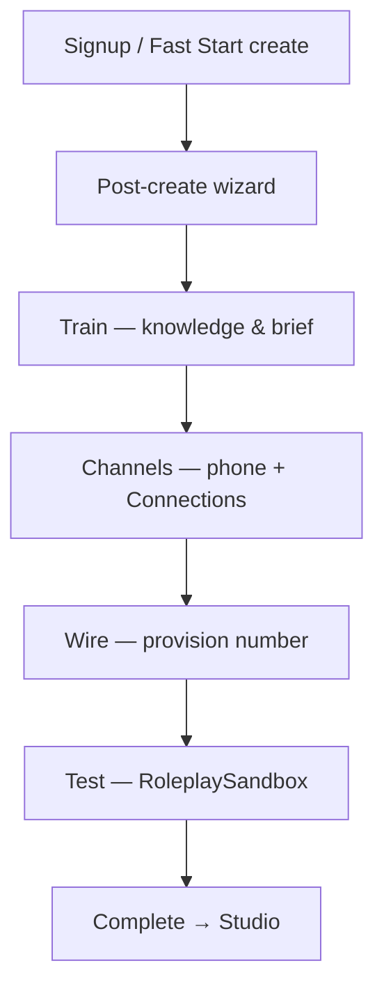

# Wireline 2026: Product Audit & Roadmap

**Status:** Active (July 2026)  
**Audience:** Engineering, design, product, growth  
**Related:** [RESEARCH_OPERATING_SYSTEM.md](./RESEARCH_OPERATING_SYSTEM.md), [business-usage-pricing-decision.md](./business-usage-pricing-decision.md), [ARCHITECTURE.md](../ARCHITECTURE.md)

---

## Executive summary

Wireline is a **voice + presenter** AI SaaS on the **Wireline Letterpress** design system (Aurora palette: cool obsidian canvas, electric-violet action, platinum-silver wire accent). The product loop is **Create → Train → Wire → Run**; activation is measured when a customer reaches a trained agent on a live line.

**Differentiation:** No major competitor blends **live conversational voice** with an **on-screen presenter** in one operator console. Retell/Vapi/Synthflow stop at audio; Synthesia/HeyGen stop at rendered video.

**This quarter (0–30 days):** Repo hygiene (done baseline), **appearance system** (Ink default + optional Paper), **post-create wizard** (Train → Channels → Wire → Test), **pricing positioning**, presenter PSTN honesty, verification discipline.

**Next quarters:** Avatar/video MVP hardening, channel integrations, analytics, GTM — see [30/90/180 roadmap](#roadmap-3090180-days) and [RESEARCH_OPERATING_SYSTEM.md](./RESEARCH_OPERATING_SYSTEM.md).

---

## 1. Codebase & infrastructure audit

### Repository hygiene (current state)

| Item                                   | Status | Notes                                    |
| -------------------------------------- | ------ | ---------------------------------------- |
| `README.md`                            | ✅     | Vision, setup, verify commands           |
| `ARCHITECTURE.md`                      | ✅     | Runtime boundaries, security             |
| `CODEBASE_HEALTH.md`                   | ✅     | Branching, deletion policy               |
| `docs/README.md`                       | ✅     | Canonical doc index                      |
| `docs/REPO_HEALTH_AUDIT_2026-07-04.md` | ✅     | Health pass findings                     |
| CI `npm run verify:full`               | ✅     | Lint, design, authz, tests, build, smoke |
| Contract tests                         | ✅     | Product voice, agent flow, docs          |

**Ongoing:** Keep generated artifacts out of git; promote durable decisions from `docs/superpowers/**` into canonical docs.

### Security & secrets

- `.gitignore` excludes env and build output.
- **Ops follow-ups (not code-only):** Enforce custom-auth breached-password screening; confirm production Upstash Redis; live Stripe webhook proof; `SENTRY_DSN` in Vercel.
- RLS on Supabase user/agent/billing tables — see [ARCHITECTURE.md](../ARCHITECTURE.md).

### Deployment

- **Frontend/API:** Vercel.
- **Data:** Supabase Postgres. **Auth:** Wireline-owned email/password + internal JWT sessions.
- **Voice:** WebRTC/Twilio/Vapi paths — audio does not traverse Supabase Realtime.
- **Presenter:** HeyGen/LiveAvatar behind Wireline-owned copy (no vendor names in customer UI).

### Billing

- **Personal:** Free create/train; live work via Conversation Balance.
- **Team / Business:** Capacity tiers in `src/lib/plan-catalog.ts` + Stripe catalog contract tests.
- **Usage:** Meter call minutes; webhook-driven subscription state in DB.
- **Test:** Staging checkout + cancellation before major pricing campaigns.

---

## 2. Competitive landscape & pricing

### Positioning matrix (summary)

| Platform           | Live voice | Live presenter        | Self-serve | Transparent pricing |
| ------------------ | ---------- | --------------------- | ---------- | ------------------- |
| **Wireline**       | ✅         | ✅ (Studio / preview) | ✅         | ✅ Balance + tiers  |
| Retell             | ✅         | ❌                    | ✅         | ✅ ~$0.07/min       |
| Vapi               | ✅         | ❌                    | Dev-led    | ✅ ~$0.05/min       |
| Synthflow          | ✅         | ❌                    | ✅         | ✅ ~$0.08/min       |
| Bland              | ✅         | ❌                    | Sales-led  | Contract            |
| Synthesia / HeyGen | ❌ (video) | Offline video         | ✅         | Credits / subs      |

Public comparison table: `/pricing` → **Why Wireline** section.

### Pricing strategy (Wireline-native)

1. **Personal (Free):** Unlimited draft agents; pay for live minutes via Conversation Balance.
2. **Team / Business:** Monthly capacity — agents, lines, routing, approvals, integrations.
3. **Enterprise:** Annual commit, SSO, custom telephony, security review.

Benchmark: 10k min/mo × $0.07 ≈ $700 ARPU for usage-heavy SMBs; bundles and seats raise ARPU further.

**Canonical billing doc:** [business-usage-pricing-decision.md](./business-usage-pricing-decision.md).

---

## 3. UX/UI & onboarding

### 3.1 Design system — Letterpress (not generic dark SaaS)

Wireline **does not** use generic Material-style dark SaaS palettes (pure black + saturated blue/orange). Canonical tokens live in `design-tokens/wireline.tokens.json`:

| Role         | Token direction                                               |
| ------------ | ------------------------------------------------------------- |
| Canvas (Ink) | Cool near-black `#0A0A0E`                                     |
| Surface      | Layered cool graphite/violet grays                            |
| Text         | `#F5F4F8` primary                                             |
| Action       | Electric violet `#A78BFA`                                     |
| Accent       | Platinum silver `#C7CCD6`                                     |
| Typography   | Instrument Serif (display), DM Sans (body), Space Mono (meta) |

**Appearance:**

- **Ink (default):** Generated tokens — product default.
- **Paper (optional):** `src/styles/theme-light.css` — a cool near-white surface with a deeper, more saturated violet action color for high-glare environments.
- Toggle: **Settings → Customization → Appearance** (`ThemeProvider`, `localStorage: wireline-theme`).

**Accessibility:** WCAG AA contrast on Ink and Paper; 44px touch targets; visible focus; icon + text status labels.

### 3.2 Chat & call UI patterns

- Typing / processing feedback in Studio and simulator.
- Presenter circular avatar in preview; enlarged video window when live presenter enabled.
- Transcript/history in call logs and Studio review surfaces.
- Quick actions and starter prompts in Studio empty states.

### 3.3 Onboarding wizard (implemented path)

**Components:** `PostCreateActivationWizard.tsx`, `wireline-onboarding-copy.ts`, `CreateAgentDialog.tsx` → `stashPostCreateWizard`.

**Future:** Persist wizard across refresh (sessionStorage without immediate consume); pre-signup 6-step marketing wizard is out of scope for authenticated FTUX.

---

## 4. Technical architecture & performance

| Layer                | Choice                                                      |
| -------------------- | ----------------------------------------------------------- |
| Real-time audio      | WebRTC / Twilio / Vapi — not Supabase Realtime              |
| Signaling / state    | Supabase + API                                              |
| STT / LLM / TTS      | Provider abstraction; streaming inference                   |
| Presenter lip-sync   | MP3 decode path + browser PCM for preview                   |
| PSTN presenter voice | Falls back to voice library — **disclosed in voice picker** |
| Billing events       | Stripe webhooks → usage records                             |
| Target latency       | &lt;250ms perceived turn-taking; monitor jitter             |

See [GROK_LIVE_VOICE.md](./GROK_LIVE_VOICE.md) for xAI live path.

---

## 5. Roadmap (30/90/180 days)

| Horizon     | Engineering                                                            | Product / UX                            | GTM                           |
| ----------- | ---------------------------------------------------------------------- | --------------------------------------- | ----------------------------- |
| **0–30d**   | Roadmap doc, theme toggle, wizard channels, pricing table, verify:full | Letterpress polish, presenter PSTN copy | Pricing page narrative        |
| **30–90d**  | Avatar MVP, Twilio/connections hardening, a11y pass                    | Studio presenter UX, beta checklist     | Teaser campaign, early access |
| **90–180d** | Analytics dashboard, scaling, multilingual                             | Advanced video, script library          | Public launch, partnerships   |

Detailed research lanes and KPI taxonomy: [RESEARCH_OPERATING_SYSTEM.md](./RESEARCH_OPERATING_SYSTEM.md).

---

## 6. KPIs (targets — validate with analytics)

| Metric                     |   30d |   90d |   180d |
| -------------------------- | ----: | ----: | -----: |
| Monthly visitors           | 2,000 | 5,000 | 12,000 |
| Sign-ups                   |   200 |   800 |  3,000 |
| Activated agents (1+ call) |   100 |   400 |  1,500 |
| Paid conversion            |    5% |   10% |    15% |
| MRR (est.)                 |   $2k |  $15k |   $80k |
| 30d retention              |   80% |   85% |    90% |
| CSAT                       |   80% |   85% |    90% |

**Instrumentation events:** `agent-created`, `first-call-made`, `upgrade-to-paid`, wizard step completion.

---

## 7. Risks & mitigations

| Risk                    | Mitigation                                                       |
| ----------------------- | ---------------------------------------------------------------- |
| Technical debt          | `verify:full` on merge; contract tests on activation funnel      |
| Latency                 | Streaming STT/LLM/TTS; WebRTC; graceful “agent thinking” UI      |
| Accessibility           | Ink/Paper contrast audit; focus rings; reduced-motion respect    |
| Competition             | Own voice+presenter niche; community + fast iteration            |
| Compliance              | Encryption in transit (WebRTC); retention controls; consent copy |
| Presenter PSTN mismatch | Explicit routing hint + future: block or dual-voice config       |

---

## 8. Implementation checklist (July 2026 sprint)

### Done in this pass

- [x] `docs/WIRELINE_2026_ROADMAP.md` (this document)
- [x] Ink / Paper / System theme (`ThemeContext`, `theme-light.css`, Appearance settings)
- [x] Post-create wizard **Channels** step
- [x] Pricing **Why Wireline** competitor section
- [x] Stronger presenter PSTN routing hint in voice catalog
- [x] Aurora palette rebrand (violet action / silver wire / obsidian canvas) across every generated and hand-authored surface

### Next (priority order)

- [ ] Push `414eb50e` workspace polish if not on `origin/main`
- [x] Wizard persistence across refresh and cross-route navigation
- [ ] Integration tests: theme storage, pricing section, wizard channels
- [ ] Supabase advisor fixes (leaked password protection)
- [ ] Production Stripe live checkout proof
- [x] Studio banner when agent uses presenter voice on phone-only deployments

---

## 9. Owners (illustrative)

| Workstream              | Owner              |
| ----------------------- | ------------------ |
| Engineering / infra     | Dev lead           |
| Letterpress UX          | Design + frontend  |
| Onboarding & activation | Product + frontend |
| Billing & pricing       | Product + backend  |
| GTM & content           | Growth             |

Track issues on GitHub project board; link PRs to sections in this doc when closing milestones.

---

_Last updated: 2026-07-05. Refresh competitor pricing quarterly. Promote superseded sections into historical notes rather than deleting decision context._
