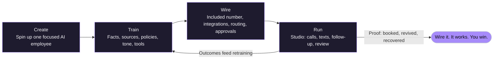
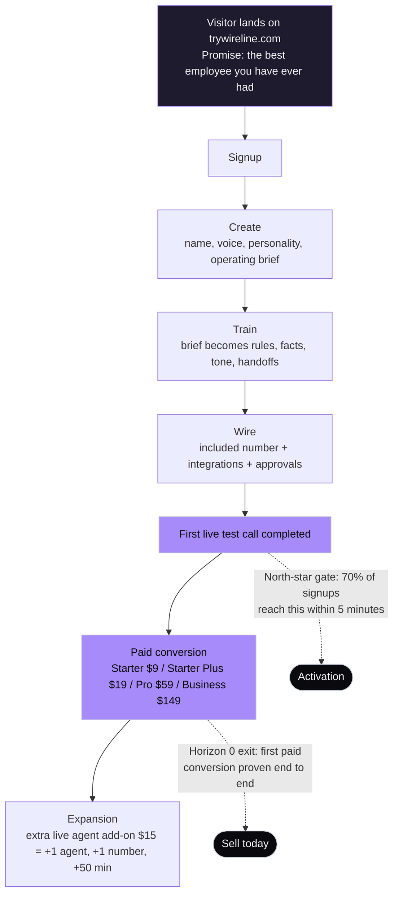
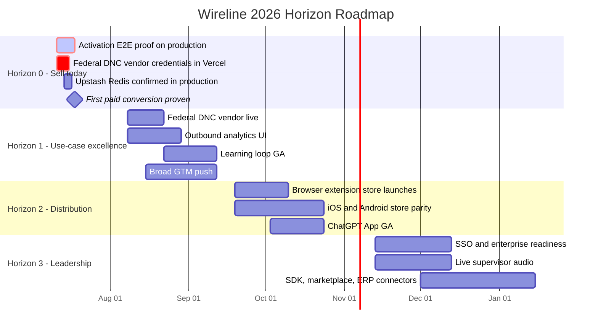
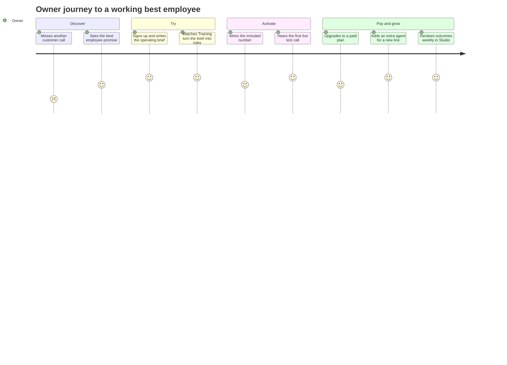
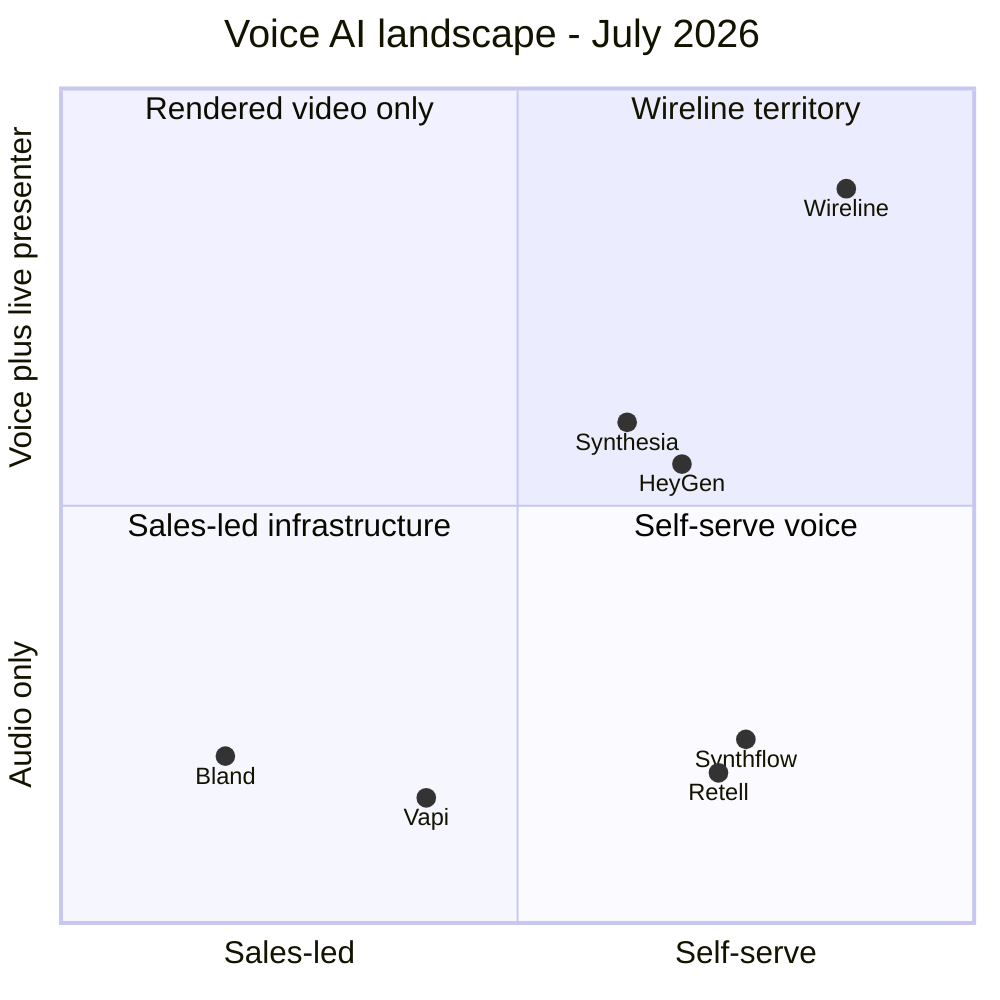
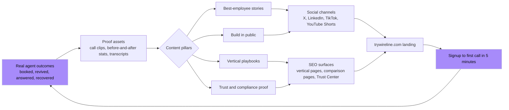
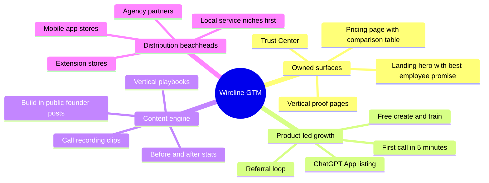

# Wireline Visual Operating Pack — July 2026

Status: **Active** · Created 2026-07-11 · Companion board: [Wireline Launch Command Center (Miro)](https://miro.com/app/board/uXjVH82__SM=/)

This pack turns the current launch doctrine into shareable visuals for planning, content, and marketing. Every diagram below was validated and rendered through the Mermaid Chart connector; the same system lives on the Miro board for collaborative planning. Sources of truth: [WIRELINE_FORWARD_PLAN_2026-07.md](./WIRELINE_FORWARD_PLAN_2026-07.md), [WIRELINE_CEO_LAUNCH_CHECKLIST_2026-07-10.md](./WIRELINE_CEO_LAUNCH_CHECKLIST_2026-07-10.md), [ONE-AGENT-STRATEGY.md](./ONE-AGENT-STRATEGY.md), [LAUNCH_OPERATING_SYSTEM.md](./LAUNCH_OPERATING_SYSTEM.md), [WIRELINE_2026_ROADMAP.md](./WIRELINE_2026_ROADMAP.md).

## How to use this pack

| Diagram | Use it for |
| --- | --- |
| 1. Product loop | Landing/pitch explainers, onboarding docs, investor one-pagers |
| 2. Activation funnel | Weekly funnel review; deciding what to ship against friction |
| 3. Horizon roadmap | Planning; sequencing; saying no to non-Horizon-0 work |
| 4. Customer journey | Marketing copy, ad angles, onboarding empathy checks |
| 5. Competitive quadrant | Pricing/comparison pages, sales conversations |
| 6. Content engine flywheel | Content strategy; keeping content tied to real proof |
| 7. GTM channel map | Channel prioritization and marketing planning |

## 1. Product loop

The core explainer: one trained AI employee, one loop, outcomes feed retraining.

## 2. Activation funnel

Horizon 0 lives or dies on this funnel. The two dotted gates are the numbers that matter.

## 3. Horizon roadmap

Dates are working targets anchored to the forward plan's week ranges (Horizon 1 = weeks 4–10, Horizon 2 = weeks 10–18, Horizon 3 = weeks 18+ from 2026-07-11).

## 4. Customer journey

The emotional arc marketing copy should mirror: pain → relief → proof → expansion.

## 5. Competitive positioning

From the positioning matrix in [WIRELINE_2026_ROADMAP.md](./WIRELINE_2026_ROADMAP.md): no major competitor blends live conversational voice with an on-screen presenter in one self-serve operator console.

## 6. Content engine flywheel

Content stays honest because it starts from real agent outcomes, and every published piece routes back to activation.

## 7. GTM channel map

## Miro Launch Command Center

Collaborative counterpart to this pack: **[Wireline Launch Command Center](https://miro.com/app/board/uXjVH82__SM=/)**.

| Frame | Contents |
| --- | --- |
| 1 · North Star & Positioning | Category, promise, secondary copy, audiences, banned framings, pricing ladder, activation goal |
| 2 · Horizon Roadmap 2026 | Horizon 0–3 phase cards with per-horizon workstream stickies and the Horizon 0 exit gate |
| 3 · Activation Funnel | Eight-step funnel with the 70%/5-minute and first-paid-conversion gates |
| 4 · Content Engine Flywheel | Outcomes → proof → publish → landing → activation cycle with the four content pillars |
| 5 · 30-Day Content Calendar | 14 launch-window content pieces with week, pillar, channel, CTA, and status columns |
| 6 · Marketing Channel Plan | Nine channels with motion, cadence, KPI, and Live/Ramp/Next status |
| 7 · Weekly Operating Cadence | Monday–Friday operating rhythm plus always-on compliance rules |

## Maintenance

- Update the Gantt dates when a horizon gate is passed; the forward plan's week ranges are the source of truth.
- Keep pricing figures in sync with [WIRELINE_CEO_LAUNCH_CHECKLIST_2026-07-10.md](./WIRELINE_CEO_LAUNCH_CHECKLIST_2026-07-10.md) and `src/lib/plan-catalog.ts`.
- The content calendar and channel plan on the Miro board are working surfaces — edit them there; this doc only records the system.
- Marketing rules still apply everywhere: truthful proof only, no vendor names on customer surfaces, no CEO-first language.
