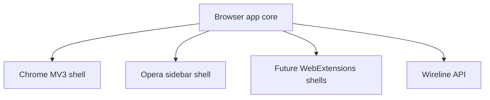

# Wireline Browser App Platform Plan

## Objective

Create a Wireline browser app platform that can ship as:

1. Chrome extension with Manifest V3, action popup, side panel, content script, and service worker.
2. Opera sidebar extension using Opera `sidebar_action` with the same core product UI and browser adapter layer.
3. Future browser surfaces that reuse the same app core wherever the WebExtensions model is compatible.

The goal is one Wireline browser product with browser-specific packaging, not separate products.

## Core Product Promise

Wireline should feel like a compact operating layer beside the user's browsing:

- summarize the current page or selected text
- capture leads, companies, tasks, or support context into Wireline
- draft follow-ups from page context
- open the right Wireline workspace route for the current job
- expose a small always-available assistant panel without forcing users back into the full web app

## Architecture



## Shared Code Strategy

Use the same React/Vite foundation already in Wireline, but split browser-specific logic behind adapters.

Recommended structure:

```text
src/browser-app/
  core/
    BrowserApp.tsx
    routes.tsx
    useBrowserSession.ts
    usePageContext.ts
    browser-bridge.ts
    types.ts
  adapters/
    chrome.ts
    opera.ts
    webext.ts
  surfaces/
    SidePanel.tsx
    Popup.tsx
    Options.tsx
    ContentBridge.ts
  styles/
    browser-app.css
  index.chrome.tsx
  index.opera.tsx
  background.chrome.ts
  background.opera.ts
  content-script.ts
extension/
  chrome/manifest.json
  opera/manifest.json
scripts/
  build-browser-extension.mjs
```

The shared core should own product behavior. The adapters should own API differences:

| Concern | Shared core | Chrome adapter | Opera adapter |
| --- | --- | --- | --- |
| UI | React app, routes, state | Mount in side panel/popup | Mount in sidebar panel |
| Auth | Wireline session handoff | `chrome.identity` or web auth flow wrapper | Opera-compatible web auth flow wrapper |
| Page context | Normalized page snapshot | `chrome.tabs`, `chrome.scripting` | Opera/Chrome-compatible extension APIs where available |
| Persistent panel | Shared side-panel UI | `chrome.sidePanel` | `sidebar_action` panel |
| Background work | Commands/events abstraction | MV3 service worker | Opera background/event page equivalent depending support |

## Browser Surface Matrix

| Surface | Chrome | Opera | Notes |
| --- | --- | --- | --- |
| Toolbar action popup | Yes | Yes | Fast actions and auth status. |
| Persistent side panel/sidebar | `chrome.sidePanel` | `sidebar_action` | Same React surface, different manifest keys. |
| Content script | Yes | Yes where compatible | Read selected text/page metadata only after user action. |
| Context menu | Yes | Likely compatible | `Send to Wireline`, `Summarize selection`, `Draft follow-up`. |
| Options page | Yes | Yes | Environment, diagnostics, support, permissions explainer. |
| Full web app deep links | Yes | Yes | Routes back to `https://trywireline.com`. |

## Initial MVP

### MVP 1: Companion Panel

- Open Wireline browser panel from toolbar/sidebar.
- Show signed-in state and current workspace/account.
- Show current tab title, URL, selected text if available.
- Buttons:
  - Summarize page
  - Save to Wireline
  - Draft follow-up
  - Open in Wireline
- Send page context to a new or existing server endpoint with strict auth and tenant checks.

### MVP 2: Context Capture

- Capture structured objects:
  - lead/contact
  - company/account
  - support thread
  - meeting/task
  - knowledge note
- Let user pick an assistant/agent destination.
- Store source URL, title, timestamp, and user-confirmed excerpt.

### MVP 3: Browser Workflow Actions

- Right-click selected text -> send to Wireline.
- Shortcut command -> open panel and attach current page context.
- Optional notification when save/draft completes.

## Security And Privacy Rules

- No passive page scraping.
- No broad host permissions by default.
- Prefer `activeTab` plus user-triggered capture.
- Content scripts should collect only selected text, page title, canonical URL, and explicitly requested metadata.
- Never store raw page content locally longer than needed for the active request.
- All API writes must be tenant-scoped and auth-checked server-side.
- Extension should expose a clear permissions explainer in the options page and store listing.

## Auth Strategy

Recommended first pass:

1. Extension opens Wireline web auth in a tab/window.
2. Web app creates/refreshes a browser-extension session through a server endpoint.
3. Extension stores a short-lived session marker in extension storage.
4. API calls use a server-issued token/session that is scoped to browser extension actions.

Avoid putting long-lived secrets in extension code. Avoid OpenAI keys in the extension. The extension talks only to Wireline API; Wireline server talks to providers.

## API Needs

Likely endpoints:

```text
GET  /api/browser/session
POST /api/browser/context/preview
POST /api/browser/context/save
POST /api/browser/draft
GET  /api/browser/destinations
POST /api/browser/telemetry
```

Every endpoint should enforce:

- authenticated user
- tenant/account scope
- rate limits
- payload size limits
- explicit action type
- audit event for writes

## Build Outputs

```text
dist/extensions/chrome/
dist/extensions/opera/
```

The build script should:

1. Build shared browser UI bundle.
2. Emit Chrome manifest with `manifest_version: 3`, `side_panel`, service worker, popup, content script, and minimal permissions.
3. Emit Opera manifest with `sidebar_action`, popup if useful, compatible background/content entries, and minimal permissions.
4. Copy icons and static assets.
5. Zip each output for store upload/manual install.

## Implementation Phases

### Phase 0: Spec And Scaffolding

- Add this plan.
- Create `src/browser-app` skeleton.
- Add placeholder manifests.
- Add `npm run browser:build`, `browser:build:chrome`, and `browser:build:opera` scripts.

### Phase 1: Local Extension Shell

- Chrome side panel opens and renders Wireline shell.
- Opera sidebar renders same shell.
- Popup opens and deep-links into panel.
- Options page renders diagnostics and permissions explanation.

### Phase 2: Auth And Read-Only Context

- Sign in with Wireline account.
- Display current user/workspace.
- Read current tab title/URL after user action.
- Read selected text after user action.

### Phase 3: Wireline Actions

- Save page/selection as knowledge note.
- Draft follow-up from selected context.
- Send item to selected assistant/agent.

### Phase 4: Store Readiness

- Permissions audit.
- Privacy policy language.
- Chrome Web Store listing assets.
- Opera add-ons listing assets.
- Manual QA matrix across Chrome, Edge, Brave, Opera, and Opera GX.

## Open Questions

1. Should the browser app be included in the main Wireline repo or split into a separate `wireline-browser` package after MVP?
2. Should the first release require a logged-in Wireline account, or allow a limited anonymous capture-to-signup flow?
3. Which first user segment matters most: personal assistant users, sales/business agents, or support/admin operators?
4. Do we want a companion panel that feels like mini-Wireline, or a narrower capture/draft utility first?

## Current Recommendation

Start in the main Wireline repo for speed and reuse. Build one shared React browser app core and generate Chrome/Opera outputs from that core. Ship a narrow MVP first: authenticated side panel/sidebar, current page context, save to Wireline, draft follow-up, and deep link back into the workspace.
